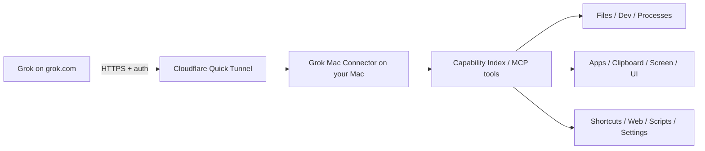

# Grok Mac Connector

> **Give Grok hands on your Mac — while keeping the Mac owner in control.**

[](#status)
[](#requirements)
[](LICENSE)

Grok Mac Connector is a free, open-source macOS menu-bar app that gives Grok (grok.com) a secure, authenticated MCP set of tools for working on your Mac.

**Unofficial community project. Not affiliated with or endorsed by xAI.**

Based on the architecture of [muse-mac-connector](https://github.com/dkm90x/muse-mac-connector).

## The simple version

1. Download **Grok Mac Connector** from GitHub Releases (or build from source).
2. Open the app. A small circle appears in the Mac menu bar — hover it anytime to see status and controls.
3. Wait for **Ready**. The app creates a free Cloudflare Quick Tunnel and shows the MCP URL.
4. Go to [grok.com/connectors](https://grok.com/connectors) → **New Connector** → **Custom**.
5. Paste the tunnel URL (the app can copy it for you).
6. Complete any auth Grok requests (OAuth or bearer).

The app stays in the menu bar so you always know it’s running. Click the icon for status, reconnect, capabilities, Full Computer Mode, or to quit.

If the Mac restarts or the free tunnel changes, open the app again. It reconnects and copies the new setup.

## Status

**v0.1.0 alpha — Initial Grok adaptation.**

Forked from Muse Mac Connector v0.5 and retargeted for Grok’s custom MCP connector flow on grok.com.

The downloadable build is currently ad-hoc signed, not Apple Developer ID signed/notarized. macOS may show an extra Gatekeeper warning. If that happens, use Finder's **Open** command or the **Open Anyway** option in Privacy & Security after verifying you downloaded it from this repository.

## What it can do

When enabled, the capability index exposes the same packs as the Muse version (files, commands, processes, apps, clipboard, screen, UI, shortcuts, web, scripts, settings) plus the consent-gated Full Computer Mode.

- **Files:** Restricted Mode uses configured roots; Full Computer Mode can list, read, write, create, move, copy, and trash files anywhere the logged-in account can access.
- **Developer commands:** Restricted Mode uses guarded single-command execution; Full Computer Mode supports general Terminal-style command strings.
- **Processes, Apps, Clipboard, Screen, UI, Shortcuts, Web, Scripts, Settings** — same as the original.

Grok discovers the machine-readable version at `GET /capabilities` and the MCP tools.

## Full Computer Mode

The connector starts conservatively. To expose the complete capability index:

1. Click the menu-bar circle.
2. Choose **Enable Full Computer Mode**.
3. Read the explanation and approve it.

Full Computer Mode removes the connector's configured-folder and conservative-command fences. Grok can work anywhere the logged-in Mac account can access and can run general Terminal-style command workflows. It does **not** bypass macOS privacy or privilege controls.

## Menu-bar controls

- **How to Use — Easy Steps** — the plain-language setup instructions for Grok.
- **Capability Index** — shows the current capability packs and enabled state.
- **Enable Full Computer Mode** — explicit opt-in to all capability packs.
- **Copy MCP URL** — copies the current Cloudflare tunnel URL for grok.com/connectors.
- **Reconnect & Copy Setup** — creates a fresh Quick Tunnel and copies the replacement setup.
- **Copy Access Key** — copies the Keychain-backed access key if needed.
- **Permissions & Capabilities** — opens the relevant macOS permission settings.
- **Advanced Setup** — opens config, scripts, and connector data locations.
- **Pause Agent** — blocks new requested actions without quitting the app.
- **Stop Connector / Quit Connector** — stops the local services cleanly.

The menu-bar icon is always visible while the app is running so you can check status at a glance.

## How it works



The AI runs in the cloud. The actual computer actions run on your Mac. The free edition uses an outbound Cloudflare Quick Tunnel, so you do not need to buy a domain, configure DNS, or expose a router port.

## Security model

- Local API binds to `127.0.0.1:8899` (or configurable).
- Remote access uses an outbound HTTPS Cloudflare tunnel.
- Every request requires authentication (bearer key stored in Keychain, or OAuth flow for Grok).
- Restricted Mode bounds file operations to configured roots and uses conservative command parsing.
- Full Computer Mode is explicit opt-in and removes those connector authority fences.
- macOS Accessibility, Screen Recording, Automation, Full Disk Access, admin/password prompts, TCC, and SIP remain under macOS control.
- **Pause Agent** immediately blocks new requests.
- No analytics, telemetry, folder watching, or project-owned backend.

See [SECURITY.md](SECURITY.md) and [PRIVACY.md](PRIVACY.md). This is an alpha and has not undergone an independent security audit.

## Requirements

For the downloadable app: macOS.

For source builds: macOS, Python 3, Homebrew, and `cloudflared`.

## Build from source

```bash
git clone https://github.com/dkm90x/grok-mac-connector.git
cd grok-mac-connector
./install.sh
./build-app.sh
```

The standalone app is created at:

```text
dist/Grok Mac Connector.app
```

The build bundles its Python runtime/dependencies and `cloudflared`, so users do not need to run a startup command.

## Run from source

```bash
./install.sh
./start-secure.sh
```

## Configuration

Choose **Advanced Setup → Open Config File** to edit:

```text
~/Library/Application Support/Grok Mac Connector/config.yaml
```

## Project structure

```text
connector/      menu-bar app, tunnel/process supervision, Keychain integration
mac_agent/      authenticated HTTP/MCP API, capability registry, guarded Mac actions
tests/          operator, security, and public-hygiene tests
build-app.sh    standalone .app build pipeline
```

## License

Released under the **MIT License**. See [LICENSE](LICENSE).

Built by **Jordan (@dkm90x)**. Based on muse-mac-connector. Contributions, testing, issue reports, and security-minded review are welcome.
